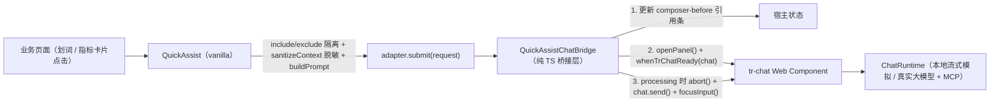

<script setup>
import { useData } from 'vitepress'
const { theme } = useData()
</script>

# QuickAssist 与 TrChat 联合实践

`QuickAssist`（`@opentiny/tiny-robot/vanilla`）负责页面级轻量 AI 触发、推荐问题、有限上下文采集与脱敏；`tr-chat` Web Component（`@opentiny/tiny-robot-chat/experimental`）负责完整的流式多轮对话、会话历史、模型切换、MCP 工具与悬浮/侧栏交互。两者均**不绑定前端技术栈**，可以组合接入原生 JS、React、Angular、Vue 等各类前端工作台。

> [!TIP]
> 本页先提供**免 API Key 的在线真机交互示例**（真实运行 `QuickAssist` 与 `<tr-chat>` Web Component），随后总结联合接入的 5 个关键工程要点，并给出 **原生 JS、React 19、Angular 20、Vue 3** 四端可运行代码对照。

## 在线体验：云运维工作台联动

体验以下 4 个典型动作：
1. **划词即问**：正向划选左侧正文（如「竞价计费」「最小权限原则」），点击「智能帮助」并选择推荐或手动输入，右侧 `<tr-chat>` 自动接收脱敏上下文并流式回复；
2. **指标卡片主动提问**：点击监控卡片上的「问 AI」，通过 `activate({ open: 'popover' })` 直接弹出带专属推荐的输入浮层；
3. **敏感区域拦截与脱敏**：尝试划选黄色敏感凭据区不会触发入口；业务上下文中的 `tenant-demo-4812` 已通过 `sanitizeContext` 替换为 `[已脱敏]`；
4. **面板收起自动展开**：点击右上角「收起 AI 助手」，再次划词或点「问 AI」提交，面板会自动展开并在输入区上方（`renderers['composer-before']`）展示引用上下文条。

<demo
  vue="../../demos/best-practices/quick-assist-tr-chat/QuickAssistTrChatDemo.vue"
  :vueFiles="[
    '../../demos/best-practices/quick-assist-tr-chat/QuickAssistTrChatDemo.vue',
    '../../demos/best-practices/quick-assist-tr-chat/bridge.ts',
    '../../demos/best-practices/quick-assist-tr-chat/mock-runtime.ts',
  ]"
  title="QuickAssist × tr-chat 联合工作台（Vue 3 内嵌示例）"
  description="划词、点击指标卡片主动激活、上下文脱敏并驱动 tr-chat 流式回复。"
/>

## 联合架构与数据流

跨技术栈落地的关键，是将两个组件的联动逻辑抽成一层**零框架依赖的桥接模块（Bridge）**，各框架宿主只负责组件挂载、面板显隐状态与生命周期释放：



## 联合接入的 5 个关键要点

### 1. Light DOM 选区防误触（`shadowRoot: false`）

`tr-chat` 与 `tr-chat-ui` 在 Light DOM 中渲染，对话气泡和历史列表里的文本同样属于当前 `Document`。如果不限制作用范围，用户在 AI 回复中划选复制文字会再次触发 QuickAssist。

最佳实践是同时使用 `include` 圈定业务正文区域，并在 `exclude` 中显式排除聊天元素与浮窗弹窗：

```ts
const quickAssist = createQuickAssist({
  include: ['[data-qa-scope]'],
  exclude: [
    'tr-chat',
    'tr-chat-ui',
    '.assistant-history',
    '.assistant-launcher',
    '[data-sensitive]',
    '[data-ai-selection="false"]',
  ],
  adapter,
})
```

### 2. 面板冷启动与 `whenTrChatReady` 时序

业务工作台中 `tr-chat` 通常默认收起（例如隐藏在悬浮窗或侧边抽屉中）。在未就绪前调用 `chat.send()` 会抛出 `tr-chat is not ready` 错误。桥接层应统一遵循以下顺序：

```ts
await openChatPanel() // 1. 通知宿主展开浮窗或抽屉
const chatEl = await waitForChatElement(getChatElement) // 2. 等待元素挂载
await whenTrChatReady(chatEl) // 3. 等待 tr-chat 首次就绪
const accepted = await chatEl.send({ text: request.prompt }) // 4. 发送并检查返回值
if (!accepted) throw new Error('tr-chat 未接受本次消息发送')
void chatEl.focusInput() // 5. 聚焦输入框方便继续追问
```

### 3. 上下文脱敏与 `buildPrompt` 构造

QuickAssist 默认生成的 `request.prompt` 等于 `suggestion?.prompt ?? query`，**不会自动拼接选中的原文 `context.text`**，且默认不会自动替换业务敏感编号。生产接入时应成对配置：

- `sanitizeContext`：统一清洗 `text`、`selection.text`、`nearbyText` 与 `businessContext` 中的敏感标识（例如租户 ID、密钥）；
- `buildPrompt`：将脱敏后的模块信息、选中片段与用户提问组织成结构化文本，同时通过 `renderers['composer-before']` 在输入区上方展示轻量引用条（浮窗模式下界面会 Teleport 至 `body`，使用 `renderers['composer-before']` 在常规与浮窗模式下均能稳定渲染）。

### 4. 正在流式生成时的并发处理

如果用户在上一个回答尚未结束（`runtime.activeConversation.value?.requestState === 'processing'`）时再次划词提交，直接调用 `chat.send()` 会因为回合未结束而返回 `false`。桥接层应明确处理策略：

```ts
const runtime = getRuntime?.() ?? chatEl.runtime
if (runtime?.activeConversation.value?.requestState === 'processing') {
  // 策略 A：中止当前生成并发送新问题（默认）
  await runtime.actions.abort?.()
  // 策略 B：或调用 await runtime.actions.createConversation() 在新会话中提问
}
```

### 5. 层级、主题联动与双生命周期释放

- **层级**：QuickAssist 浮层默认 `z-index: 1500`，天然高于 `tr-chat` 浮窗（`1000`）与历史弹窗（`1001`）。
- **主题同步**：QuickAssist 与 `tr-chat` 默认都监听 `html[data-tr-color-mode="light" | "dark"]`，宿主只需维护同一属性即可让两者同步切换明暗色。
- **双生命周期释放**：路由切换时调用 `quickAssist.close()`；宿主卸载时成对执行 `quickAssist.destroy()` 与 `await ownedRuntime.dispose()`。

## 通用桥接层参考实现

下面这段纯 TypeScript 桥接代码不依赖任何前端框架，可直接复制到原生 JS、React、Angular 或 Vue 项目中复用：

::: details 查看完整 `quick-assist-bridge.ts`
<<< ../../../examples/tr-chat-app-react/src/chat/quick-assist-bridge.ts [src/chat/quick-assist-bridge.ts]
:::

## 多技术栈落地对照

下面展示**原生 JS、React 19、Angular 20** 三个独立可运行工作台项目的核心接入代码，以及 **原生 HTML（CDN）** 最小接入片段。三个项目共用同一套双模式 Runtime：未配置 `.env` 时自动运行**本地流式演示模式**，配置 `VITE_DEEPSEEK_API_KEY` / `VITE_ALIYUN_DASHSCOPE_KEY` 或自定义代理地址后自动切换为真实大模型。

::: code-group
<<< ../../../examples/tr-chat-app-js/src/pages/workspace-page.ts [原生 JS（workspace-page.ts）]
<<< ../../../examples/tr-chat-app-react/src/pages/workspace-page.tsx [React 19（workspace-page.tsx）]
<<< ../../../examples/tr-chat-app-angular/src/pages/workspace-page.component.ts [Angular 20（workspace-page.component.ts）]
```html [原生 HTML（CDN 触发 + tr-chat）]
<!-- 适合已有传统页面：QuickAssist 通过全局脚本引入，提交后驱动页面里的 tr-chat 元素 -->
<script src="https://cdn.jsdelivr.net/npm/@opentiny/tiny-robot@0.5.2/dist/vanilla/vanilla.global.js"></script>
<script type="module">
  import { createChatRuntime } from '@opentiny/tiny-robot-chat'
  import { defineTrChatElements, whenTrChatReady } from '@opentiny/tiny-robot-chat/experimental'
  import '@opentiny/tiny-robot-chat/experimental/web-component.css'

  defineTrChatElements()
  const chat = document.querySelector('tr-chat')
  const owned = createChatRuntime({
    modelProviders: [
      {
        type: 'openai',
        apiUrl: new URL('/api/chat/completions', location.origin).href,
        models: [{ id: 'your-model-id', label: '运维助手' }],
      },
    ],
  })
  chat.runtime = owned.runtime

  const quickAssist = window.TinyRobotVanilla.createQuickAssist({
    include: ['[data-qa-scope]'],
    exclude: ['tr-chat', 'tr-chat-ui', '[data-sensitive]'],
    buildPrompt: ({ query, context }) => `[选中内容] ${context.text}\n[提问] ${query}`,
    adapter: {
      async submit(request) {
        chat.hidden = false
        await whenTrChatReady(chat)
        await chat.send({ text: request.prompt })
        void chat.focusInput()
      },
    },
  })

  window.addEventListener('pagehide', () => {
    quickAssist.destroy()
    void owned.dispose()
  })
</script>
```
:::

## 可独立运行的示例工程

| 技术栈 | 示例目录 | 开发访问地址 | 说明 |
| --- | --- | --- | --- |
| 原生 JS + Vite | <a :href="`${theme.sourceLinks.treeBase}/examples/tr-chat-app-js`" target="_blank" rel="noreferrer">`examples/tr-chat-app-js`</a> | `http://127.0.0.1:4347/workspace` | 零框架依赖，原生 DOM 实现浮窗助手与 QuickAssist 联动 |
| Angular 20 | <a :href="`${theme.sourceLinks.treeBase}/examples/tr-chat-app-angular`" target="_blank" rel="noreferrer">`examples/tr-chat-app-angular`</a> | `http://127.0.0.1:4348/workspace` | Standalone 组件 + `afterNextRender` + `DestroyRef` + Angular Template Renderer |
| React 19 | <a :href="`${theme.sourceLinks.treeBase}/examples/tr-chat-app-react`" target="_blank" rel="noreferrer">`examples/tr-chat-app-react`</a> | `http://127.0.0.1:4349/workspace` | `useEffect` / `useImperativeHandle` + JSX `composer-before` Renderer 与浮窗联动 |
| Vue 3 | `docs/demos/best-practices/quick-assist-tr-chat/` | 当前文档页顶部 | 文档站直接交互，支持 SSR 安全懒加载 `<tr-chat>` |

### 快速切换到真实大模型

在任一示例目录中复制 `.env.example` 为 `.env`，填写至少一个服务密钥或自有后端代理地址，重启 `pnpm dev` 即可自动从「本地演示模式」切换为真实模型服务：

```env
VITE_DEEPSEEK_API_KEY=你的开发密钥
# 或
VITE_ALIYUN_DASHSCOPE_KEY=你的开发密钥
# 或配置免前端密钥的后端转发地址
VITE_DEEPSEEK_API_URL=/api/deepseek/chat/completions
```

## 相关文档

- [QuickAssist 智能帮助组件文档](/components/quick-assist)
- [TrChat Web Component 使用指南](/web-component/index)
- [Runtime 创建与释放](/web-component/runtime)
- [Web Component 内容定制](/web-component/customization)
